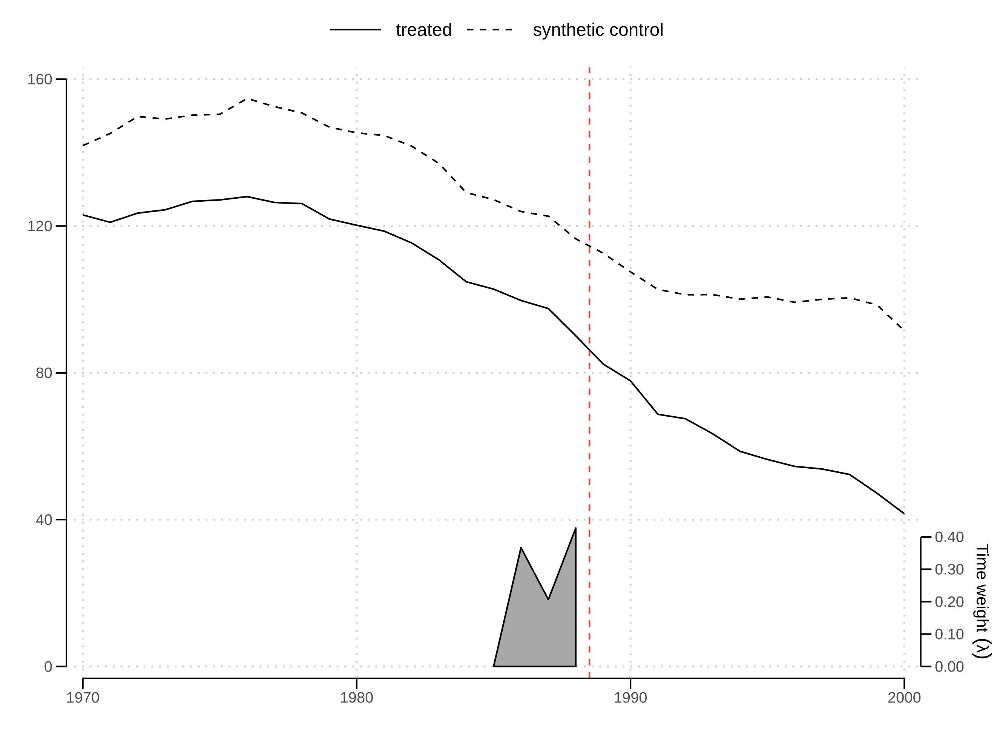
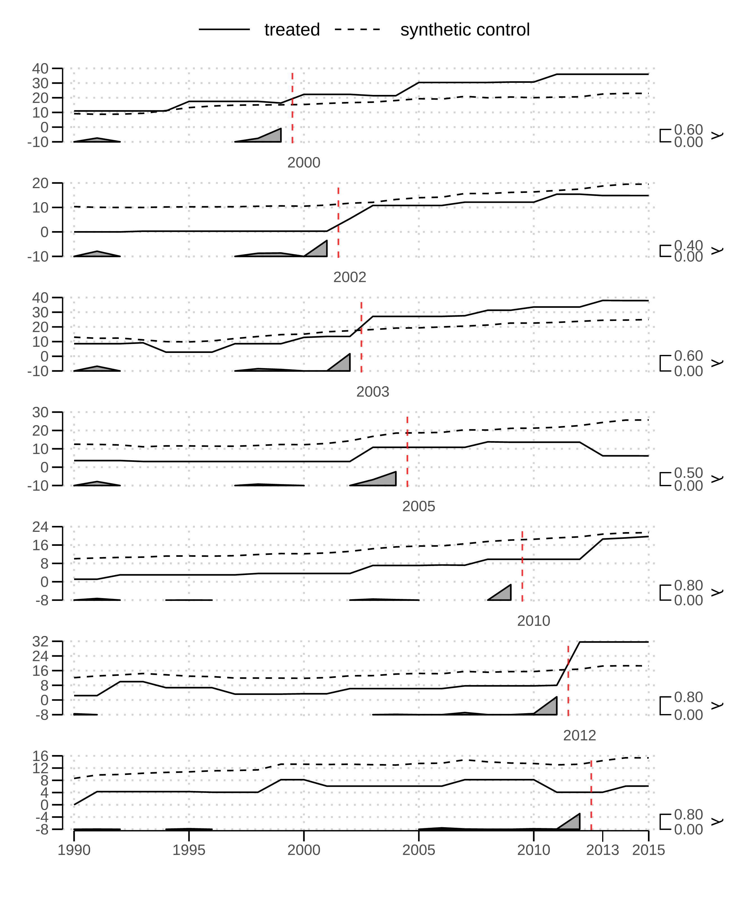
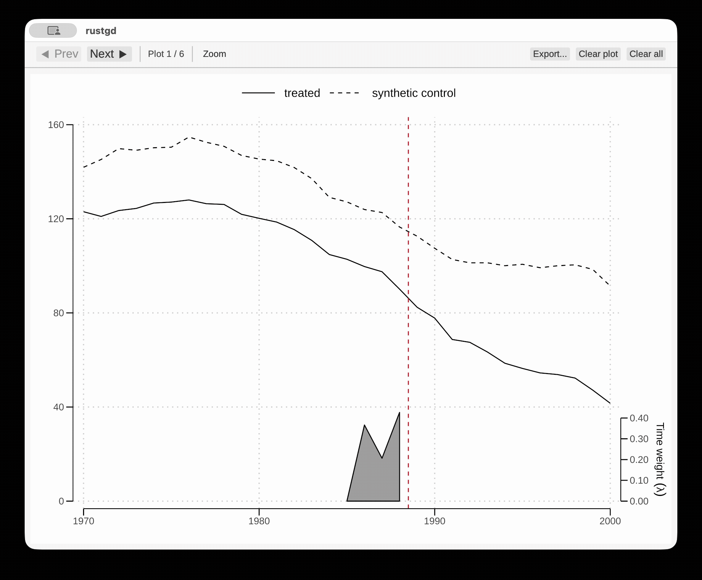

# sdid: Updated Synthetic Difference-in-Differences Estimation and Inference for R

`sdid` estimates average effects of a treatment on the treated (ATT) in panel data using synthetic difference-in-differences (SDiD), synthetic control (SC), or difference-in-differences (DiD). It follows the design of the Stata package [`sdid`](https://github.com/Daniel-Pailanir/sdid) by Clarke et al. (2024), where the function call accepts a long format panel dataset, automatically detects whether a staggered treatment approach is needed, and estimates the effect with bootstrap, jackknife, or placebo inference.

The package derives from [`synthdid`](https://github.com/synth-inference/synthdid) 0.0.9 by Arkhangelsky et al., (2021). Relative to that package, it adds staggered adoption, optimized and projected methods of covariate adjustment, compiled estimation with parallel replications, and a redesigned interface built around a consolidated function.

## Installation

The development version can be installed from GitHub.

```r
# install.packages("remotes")
remotes::install_github("alcocer-jj/sdid")
```

## Syntax

The full call is shown below, with each argument's default. For arguments that take one of several values, the first value listed is the default, except for `vce`, which has no default and must be given.

```r
sdid(
  data,
  outcome,
  unit,
  time,
  treatment,
  vce = c("bootstrap", "jackknife", "placebo", "noinference"),
  covariates = NULL,
  method = c("sdid", "sc", "did"),
  reps = 50,
  seed = NULL,
  level = 95,
  alternative = c("two.sided", "greater", "less"),
  covariate.method = c("optimized", "projected"),
  standardize = TRUE,
  projection.sample = c("controls", "untreated"),
  num.threads = NULL,
  graph = TRUE,
  quietly = FALSE,
  ...
)
```

* `data`: balanced panel in long format, one row per unit and period.
* `outcome`: name of the outcome variable.
* `unit`: name of the unit identifier.
* `time`: name of the time period variable.
* `treatment`: name of the binary treatment variable, where 1 denotes the first post-treatment period.
* `vce`: inference method (required).
* `covariates`: names of time-varying covariate variables, if any.
* `method`: synthetic DiD, synthetic control, or difference-in-differences.
* `reps`: number of bootstrap or placebo replications.
* `seed`: random seed, applied to this call only.
* `level`: confidence level, in percent.
* `alternative`: alternative hypothesis of the test of the effect against zero.
* `covariate.method`: how covariates are adjusted for.
* `standardize`: standardize covariates under the optimized method.
* `projection.sample`: regression sample under the projected method.
* `num.threads`: threads for replications, all available when NULL.
* `graph`: produce the trends plot in this call.
* `quietly`: TRUE prints nothing, for use in loops.

## Example

The example below estimates the effect of California's Proposition 99 on cigarette consumption, using placebo inference because California is the only treated state. An `sdid()` call describes the data and parameters in the console, shows the inference progress, and prints the results. 

```r
library(sdid)

data(california_prop99)

fit1 <- sdid(
  california_prop99,
  "PacksPerCapita", "State", "Year", "treated",
  vce = "placebo", reps = 1000, seed = 444
)
#> Synthetic Difference-in-Differences Estimator
#> 
#> Outcome     PacksPerCapita
#> Treatment   treated
#> Units       39 (38 never treated, 1 treated)
#> Periods     31 (1970 to 2000), treatment from 1989
#> Inference   placebo, 1000 replications
#> 
#> Placebo  [========================]  1000/1000  100%  0.2s elapsed  done  18 threads
#> 
#>               ATT Std. Err.     z P>|z| [95% Conf. Interval]
#> treated -15.60383   8.71856 -1.79 0.073  -32.69189   1.48424
#> 
#> 95% confidence intervals and p-values use the normal approximation.
```

It also draws the trends plot unless `graph = FALSE`.




## Staggered adoption

When treated units adopt treatment in different periods, `sdid()` estimates each adoption cohort, meaning the units first treated in that period together with the units never treated, as its own design. The overall effect averages the cohort effects with weights proportional to each cohort's number of treated units times its number of post-treatment periods, following Algorithm 1 of Clarke et al. (2024). Bootstrap, jackknife, and placebo inference then resamples the whole panel jointly, as in Algorithms 2 to 4 of Clarke et al. (2024).

```r
library(haven)
library(sdid)

data <- read_dta("https://github.com/Daniel-Pailanir/sdid/raw/refs/heads/main/simulations/cluster_data/quota_example_cluster.dta")

fit2 <- sdid(
  data,
  "womparl", "country", "year", "quota",
  vce = "bootstrap", reps = 1000, seed = 444
)
#> Synthetic Difference-in-Differences Estimator
#> 
#> Outcome     womparl
#> Treatment   quota
#> Units       119 (110 never treated, 9 treated)
#> Periods     26 (1990 to 2015), 7 adoption periods
#> Inference   bootstrap, 1000 replications
#> 
#> Bootstrap  [========================]  1000/1000  100%  11.4s elapsed  done  18 threads
#> 
#>           ATT Std. Err.    z P>|z| [95% Conf. Interval]
#> quota 8.03410   3.18551 2.52 0.012    1.79062  14.27758
#> 
#> Adoption-period estimates
#>      Treated Post Weight      ATT Std. Err.     z P>|z| [95% Conf. Interval]
#> 2000       1   16 0.1702  8.38887   0.69893 12.00 0.000    7.01900   9.75874
#> 2002       2   14 0.2979  6.96775   0.57747 12.07 0.000    5.83592   8.09957
#> 2003       2   13 0.2766 13.95226   8.59993  1.62 0.105   -2.90329  30.80781
#> 2005       1   11 0.1170 -3.45054   0.67457 -5.12 0.000   -4.77268  -2.12841
#> 2010       1    6 0.0638  2.74904   0.43366  6.34 0.000    1.89908   3.59899
#> 2012       1    4 0.0426 21.76272   0.86701 25.10 0.000   20.06341  23.46203
#> 2013       1    3 0.0319 -0.82032   0.81086 -1.01 0.312   -2.40958   0.76893
#> 
#> 95% confidence intervals and p-values use the normal approximation.        
```



## Covariates

Time-varying covariates are named with `covariates`, while `covariate.method` selects one of the two adjustments the package offers. The default, `"optimized"`, estimates their coefficients jointly with the weights, following Arkhangelsky et al. (2021), after standardizing each covariate. The alternative, `"projected"`, estimates them from a two-way fixed effects regression on observations without treatment, following Kranz (2022) and Clarke et al. (2024).

```r
library(sdid)

data(CPS)

fit3 <- sdid(
  CPS,
  "log_wage", "state", "year", "abort_ban",
  vce = "bootstrap", reps = 1000, seed = 444,
  covariates = c("hours", "urate"),
  covariate.method = "projected",
  graph = FALSE
)
#> Synthetic Difference-in-Differences Estimator
#> 
#> Outcome     log_wage
#> Treatment   abort_ban
#> Units       50 (32 never treated, 18 treated)
#> Periods     40 (1979 to 2018), treatment from 2018
#> Covariates  hours, urate, projected
#> Inference   bootstrap, 1000 replications
#> 
#> Bootstrap  [========================]  1000/1000  100%  1.0s elapsed  done  18 threads
#> 
#>               ATT Std. Err.    z P>|z| [95% Conf. Interval]
#> abort_ban 0.00261   0.01465 0.18 0.858   -0.02610   0.03132
#> 
#> 95% confidence intervals and p-values use the normal approximation.
```

## Tables

Results work with [modelsummary](https://modelsummary.com) and other packages that read results through `tidy()` and `glance()`, with no further setup. Each model's effect is named by its treatment column by default, so `labels = "ATT"` puts the effects of models with different treatment columns on one row. For a staggered design, `cohorts = TRUE` adds a row for each adoption period, and `labels` can then name every row, the overall effect first.

```r
library(modelsummary)

gm <- data.frame(
  raw = c("nobs", "n.units", "n.periods"),
  clean = c("Observations", "Units", "Periods"),
  fmt = 0
)

modelsummary(
  models = list("Prop 99" = fit1, "Quota" = fit2, "Abortion Ban" = fit3),
  labels = "ATT",
  gof_map = gm,
  stars = TRUE,
  output = "markdown"
)
#> +--------------+----------+---------+--------------+
#> |              | Prop 99  | Quota   | Abortion Ban |
#> +==============+==========+=========+==============+
#> | ATT          | -15.604+ | 8.034*  | 0.003        |
#> +--------------+----------+---------+--------------+
#> |              | (8.719)  | (3.186) | (0.015)      |
#> +--------------+----------+---------+--------------+
#> | Observations | 1209     | 3094    | 2000         |
#> +--------------+----------+---------+--------------+
#> | Units        | 39       | 119     | 50           |
#> +--------------+----------+---------+--------------+
#> | Periods      | 31       | 26      | 40           |
#> +==============+==========+=========+==============+
#> | + p < 0.1, * p < 0.05, ** p < 0.01, *** p <      |
#> | 0.001                                            |
#> +==============+==========+=========+==============+

modelsummary(
  models = list("Quota" = fit2),
  coef_rename = c("quota" = "Weighted ATT"),
  cohorts = TRUE,
  gof_map = gm,
  stars = TRUE,
  output = "markdown"
)
#> +--------------+-----------+
#> |              | Quota     |
#> +==============+===========+
#> | Weighted ATT | 8.034*    |
#> +--------------+-----------+
#> |              | (3.186)   |
#> +--------------+-----------+
#> | 2000         | 8.389***  |
#> +--------------+-----------+
#> |              | (0.699)   |
#> +--------------+-----------+
#> | 2002         | 6.968***  |
#> +--------------+-----------+
#> |              | (0.577)   |
#> +--------------+-----------+
#> | 2003         | 13.952    |
#> +--------------+-----------+
#> |              | (8.600)   |
#> +--------------+-----------+
#> | 2005         | -3.451*** |
#> +--------------+-----------+
#> |              | (0.675)   |
#> +--------------+-----------+
#> | 2010         | 2.749***  |
#> +--------------+-----------+
#> |              | (0.434)   |
#> +--------------+-----------+
#> | 2012         | 21.763*** |
#> +--------------+-----------+
#> |              | (0.867)   |
#> +--------------+-----------+
#> | 2013         | -0.820    |
#> +--------------+-----------+
#> |              | (0.811)   |
#> +--------------+-----------+
#> | Observations | 3094      |
#> +--------------+-----------+
#> | Units        | 119       |
#> +--------------+-----------+
#> | Periods      | 26        |
#> +==============+===========+
#> | + p < 0.1, * p < 0.05,   |
#> | ** p < 0.01, *** p <     |
#> | 0.001                    |
#> +==============+===========+
```

## Plots

The plotting functions take the result of `sdid()`, drawing one panel per adoption cohort for a staggered design, each labeled at its adoption period and with its own time-weight axis. By default, as in Stata, each numeric axis has about five nice ticks covering the data and runs between its outermost ticks. `ticks = "loose.more"` adds ticks when that would leave more than 15% of an axis beyond the data, and `ticks = "minmax"` labels the smallest and largest values at the ends of each axis instead. To choose the ticks yourself, give them as `x.breaks` and `y.breaks`, which the frame and labels follow, rather than adding a scale to the plot.

```r
sdid_plot(fit1) # trajectories and time weights

sdid_plot(fit1, style = "effects") # with a DiD effects diagram

sdid_plot(fit1, x.breaks = seq(1970, 2000, by = 5))  # custom ticks

sdid_units_plot(fit1) # unit weights

sdid_units_plot(fit1, type = "bars") # unit weights with bars instead

sdid_placebo_plot(fit1, placebo.time = 1981) # in-time placebo plot
```




## Performance

Weights are estimated in compiled code, and bootstrap, jackknife, and placebo replications run in parallel across all available threads, with identical results for any number of threads under the same seed. The option `sdid.num.threads`, or the `num.threads` argument of `sdid()`, limits the number of threads. Interrupting a run with Ctrl-C stops the replications and returns every thread.

## Acknowledgments 

Development was assisted by [Claude Code](https://claude.com/product/claude-code), an AI coding assistant by Anthropic, for code refactoring, documentation updates, and package restructuring.

## References

Arkhangelsky, Dmitry, Susan Athey, David A. Hirshberg, Guido W. Imbens, and Stefan Wager. (2021). "Synthetic Difference-in-Differences." *American Economic Review* 111(12): 4088-4118.

Clarke, Damian, Daniel Pailañir, Susan Athey, and Guido Imbens. (2024). "On Synthetic Difference-in-Differences and Related Estimation Methods in Stata." *The Stata Journal* 24(4): 557-598.

Kranz, Sebastian. (2022). "Synthetic Difference-in-Differences with Time-Varying Covariates." Working paper. <https://github.com/skranz/xsynthdid>.

## License

BSD 3-Clause. See [LICENSE.md](LICENSE.md). The package derives from synthdid 0.0.9, Copyright 2019 Stanford University, used under its BSD 3-Clause option.
