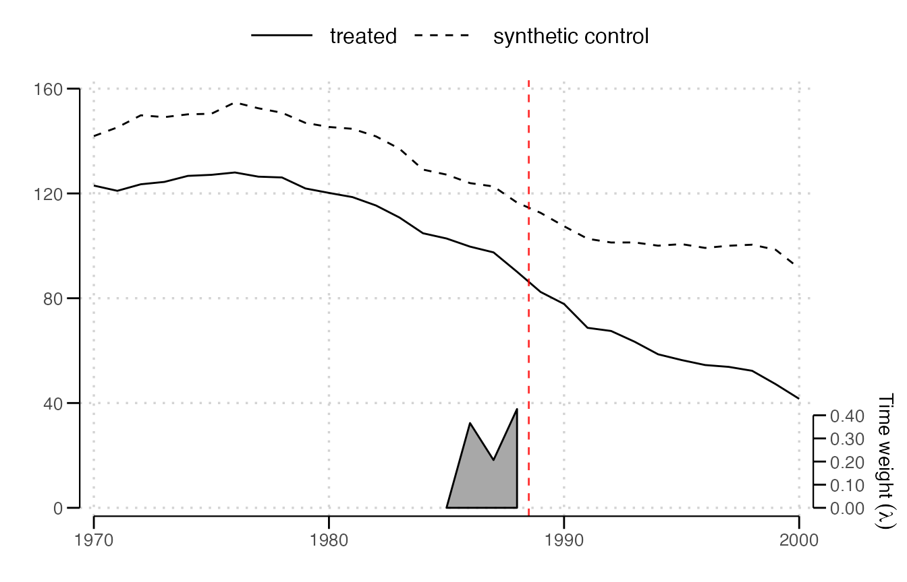
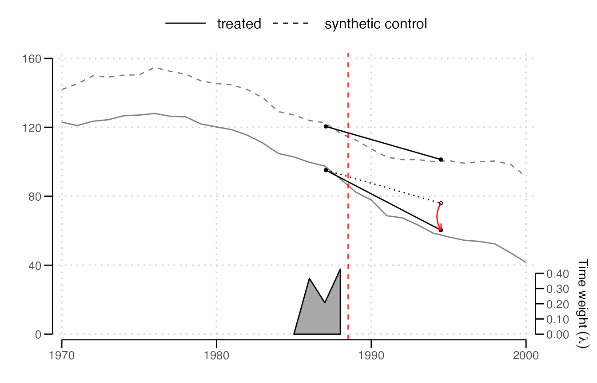
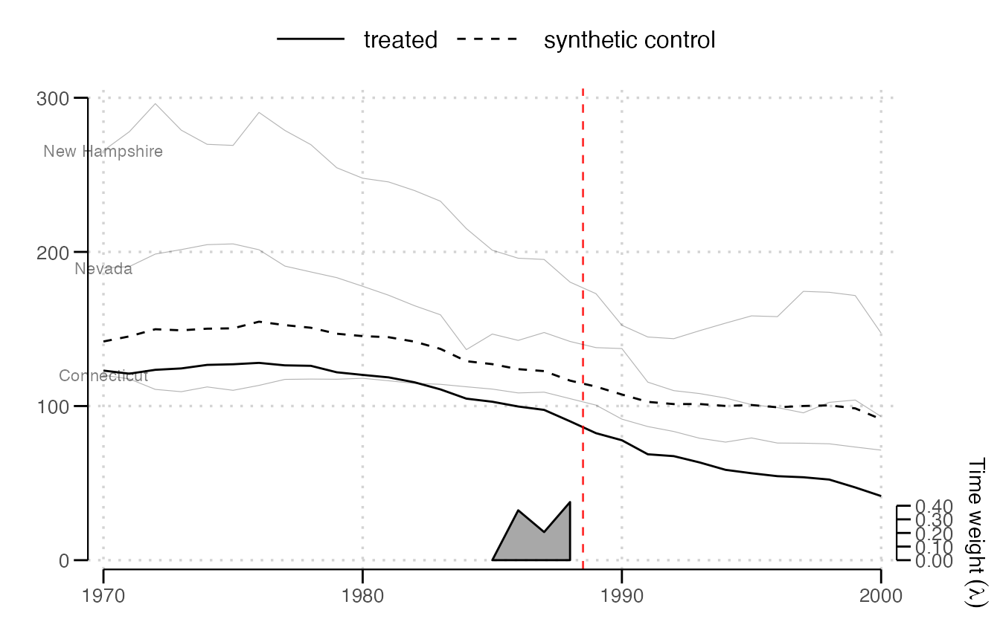
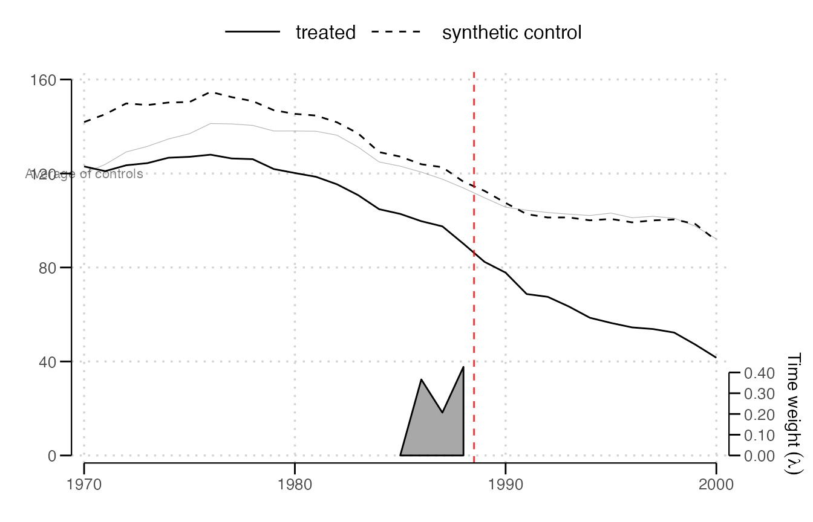
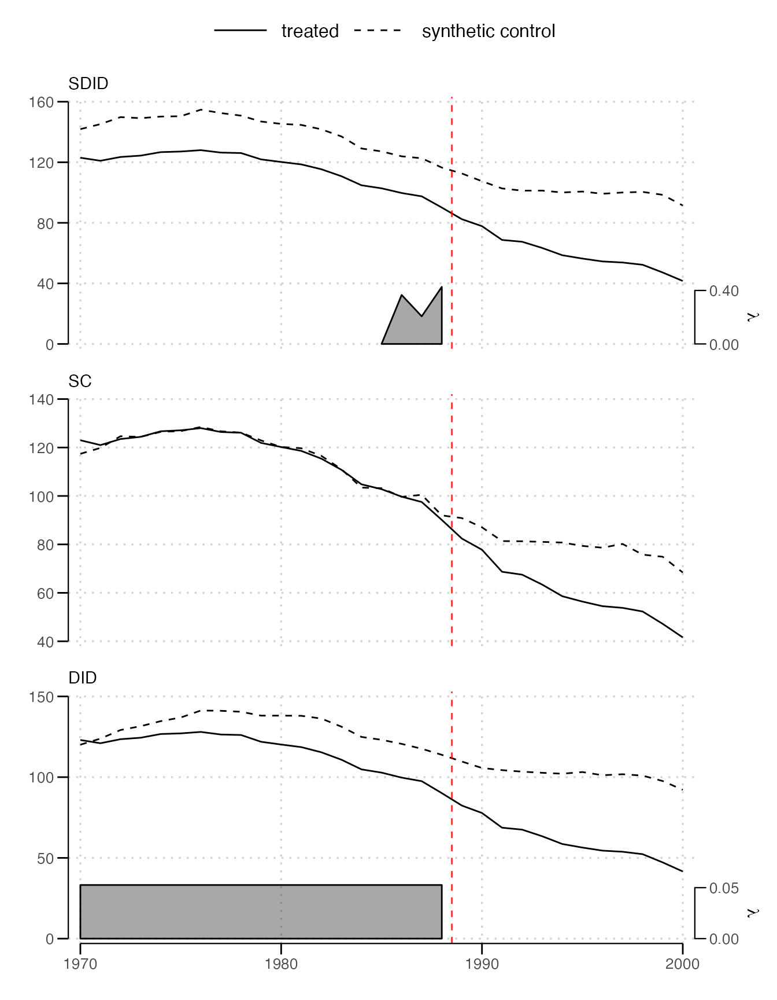
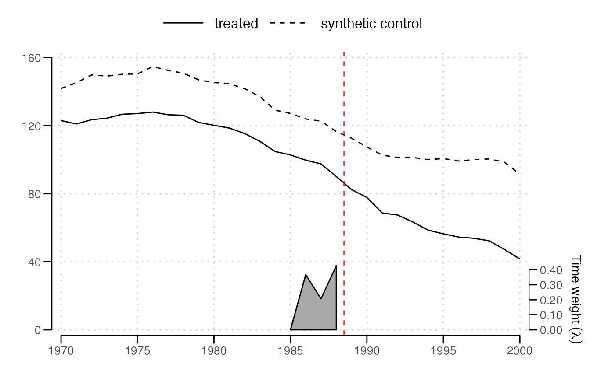
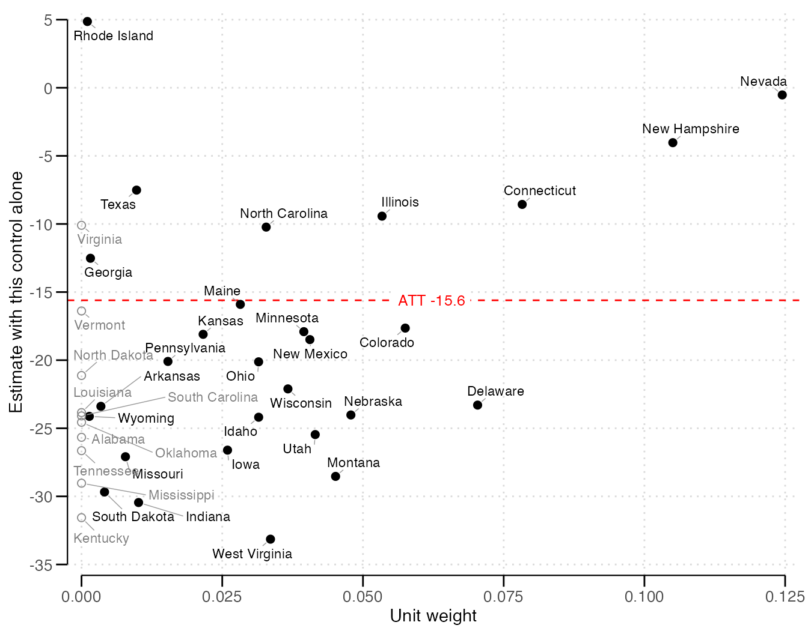
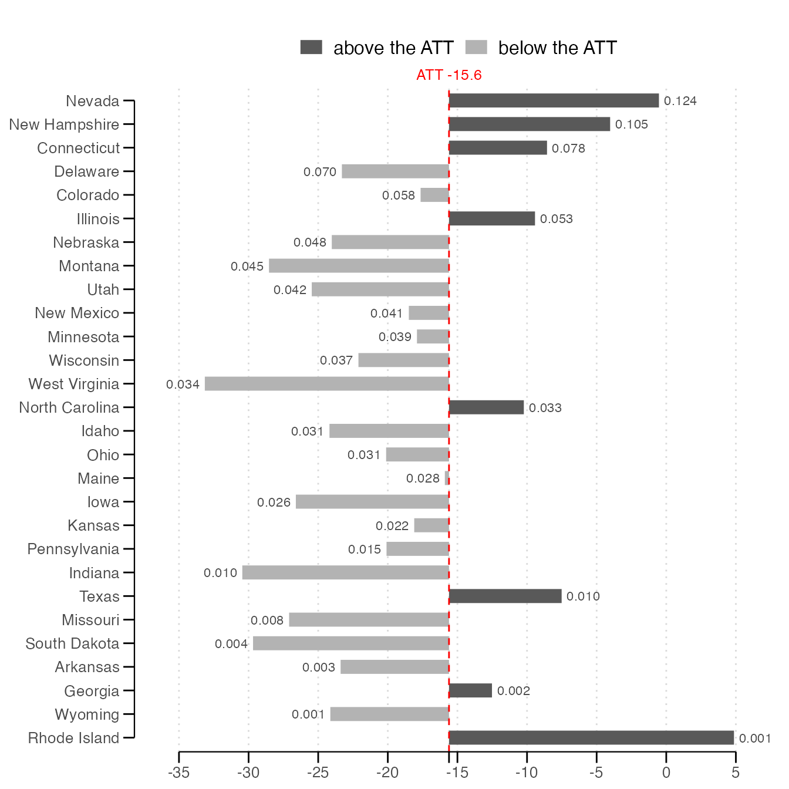
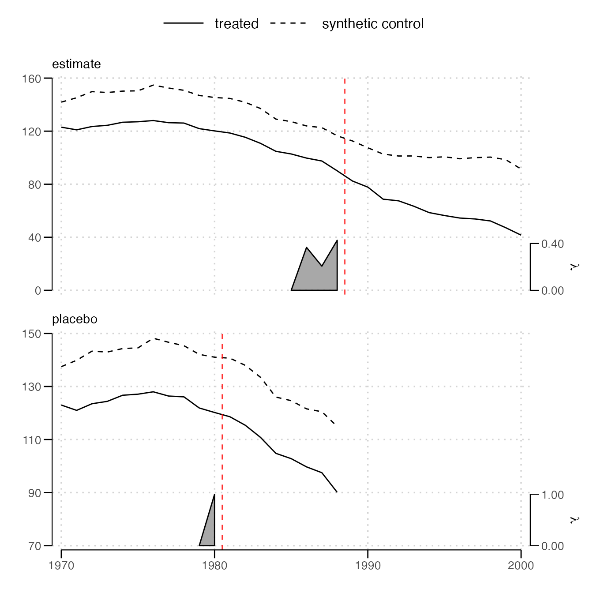

# Plotting results

The plot functions take the result of
[`sdid()`](https://alcocer-jj.github.io/sdid/reference/sdid.md) and
return ggplot objects, which draw when printed and can be extended with
`+`. They require ggplot2, and
[`sdid_units_plot()`](https://alcocer-jj.github.io/sdid/reference/sdid_units_plot.md)
uses ggrepel, when it is installed, to keep its labels apart.

\
[`library`](https://rdrr.io/r/base/library.html)`(`[`sdid`](https://github.com/alcocer-jj/sdid)`)`\
[`data`](https://rdrr.io/r/utils/data.html)`(``california_prop99``)`\
`fit`` ``=`` `[`sdid`](https://alcocer-jj.github.io/sdid/reference/sdid.md)`(``california_prop99``, ``"PacksPerCapita"``, ``"State"``, ``"Year"``, ``"treated"``,`\
`           vce ``=`` ``"placebo"``, seed ``=`` ``1213``, graph ``=`` ``FALSE``, quietly ``=`` ``TRUE``)`

## Trends

[`sdid_plot()`](https://alcocer-jj.github.io/sdid/reference/sdid_plot.md),
which [`plot()`](https://rdrr.io/r/graphics/plot.default.html) calls,
draws the treated units’ average and the synthetic control. The red
dashed line marks the start of treatment, midway between the last period
before it and the first treated period. The gray band at the bottom
shows the time weights, with their scale on the right-hand axis.

\
[`sdid_plot`](https://alcocer-jj.github.io/sdid/reference/sdid_plot.md)`(``fit``)`



The two lines may sit apart before treatment. Synthetic
difference-in-differences asks the synthetic control to move in parallel
with the treated units over the weighted pre-treatment periods, not to
match their level.

`style = "effects"` adds a diagram of the comparison behind the
estimate, with an arrow marking the effect.

\
[`sdid_plot`](https://alcocer-jj.github.io/sdid/reference/sdid_plot.md)`(``fit``, style ``=`` ``"effects"``)`



## Individual units

`spaghetti.units` adds the trajectories of chosen units, here the three
controls with the largest weights.

\
`w`` ``=`` `[`weights`](https://rdrr.io/r/stats/weights.html)`(``fit``)``$``omega`\
`top`` ``=`` ``w``$``unit``[`[`order`](https://rdrr.io/r/base/order.html)`(``-``w``$``` `1989` ```)``]``[``1``:``3``]`\
[`sdid_plot`](https://alcocer-jj.github.io/sdid/reference/sdid_plot.md)`(``fit``, spaghetti.units ``=`` ``top``, spaghetti.label.size ``=`` ``3``)`



`spaghetti.matrices` adds any other trajectories, given as a list with
one matrix per estimate, each row a trajectory with a column per period
and a row name that labels it. Here, the unweighted average of all
controls, the comparison plain difference-in-differences makes.

\
`Y`` ``=`` ``fit``$``setup``$``Y`\
`average`` ``=`` `[`rbind`](https://rdrr.io/r/base/cbind.html)`(``"Average of controls"`` ``=`` `[`colMeans`](https://rdrr.io/r/base/colSums.html)`(``Y``[``w``$``unit``, , drop ``=`` ``FALSE``]``)``)`\
[`sdid_plot`](https://alcocer-jj.github.io/sdid/reference/sdid_plot.md)`(``fit``, spaghetti.matrices ``=`` `[`list`](https://rdrr.io/r/base/list.html)`(``average``)``, spaghetti.label.size ``=`` ``3``)`



## Comparing estimators

A named list of results draws each in its own panel, stacked and labeled
by its name.

\
`estimates`` ``=`` `[`lapply`](https://rdrr.io/r/base/lapply.html)`(`[`c`](https://rdrr.io/r/base/c.html)`(``SDID ``=`` ``"sdid"``, SC ``=`` ``"sc"``, DID ``=`` ``"did"``)``, ``function``(``m``)`` ``{`\
`  `[`sdid`](https://alcocer-jj.github.io/sdid/reference/sdid.md)`(``california_prop99``, ``"PacksPerCapita"``, ``"State"``, ``"Year"``, ``"treated"``,`\
`       method ``=`` ``m``, vce ``=`` ``"noinference"``, graph ``=`` ``FALSE``, quietly ``=`` ``TRUE``)`\
`}``)`\
[`sdid_plot`](https://alcocer-jj.github.io/sdid/reference/sdid_plot.md)`(``estimates``)`



Synthetic control puts no weight on the periods before treatment, so its
panel has no band, and difference-in-differences weighs them equally.
Each band is drawn on its own scale. `lambda.comparable = TRUE` draws
them on a common scale instead, where a weight of 1 fills the band, so
that their heights can be compared across panels.

## Ticks

Each axis has about five nice ticks covering the data, as the Stata
command chooses them, and a time axis of years gets ticks only at whole
years. `x.breaks` and `y.breaks` set the ticks, which the axis range,
frame and band follow. Adding a scale to the returned plot instead
replaces the one it sets.

\
[`sdid_plot`](https://alcocer-jj.github.io/sdid/reference/sdid_plot.md)`(``fit``, x.breaks ``=`` `[`seq`](https://rdrr.io/r/base/seq.html)`(``1970``, ``2000``, by ``=`` ``5``)``)`



## Unit weights

[`sdid_units_plot()`](https://alcocer-jj.github.io/sdid/reference/sdid_units_plot.md)
shows each control’s own estimate, the difference-in-differences of the
treated units with that control alone, whose average with the unit
weights is the estimate. The default scatter plots each control’s weight
against its own estimate, with controls given no weight drawn as open
circles.

\
[`sdid_units_plot`](https://alcocer-jj.github.io/sdid/reference/sdid_units_plot.md)`(``fit``)`



The heavily weighted controls are at the right. Their spread about the
red line shows whether they agree, and the open circles show whether the
weighting changed the answer. `type = "bars"` draws the weighted
controls from the largest weight down, each bar running from the
estimate to the control’s own estimate, with its weight at the end.

\
[`sdid_units_plot`](https://alcocer-jj.github.io/sdid/reference/sdid_units_plot.md)`(``fit``, type ``=`` ``"bars"``)`



`label.units` names every control, those with weight, or the `n` with
the largest weights. For a staggered result, each cohort gets a panel,
with ten names each, unless `cohort` chooses one.

## Placebo tests

[`sdid_placebo_plot()`](https://alcocer-jj.github.io/sdid/reference/sdid_placebo_plot.md)
draws the estimate above an in-time placebo, which pretends treatment
began earlier, at `placebo.time`, using only the periods before the real
treatment. Where nothing happened, the placebo’s lines should keep
tracking each other after its red line.

\
[`sdid_placebo_plot`](https://alcocer-jj.github.io/sdid/reference/sdid_placebo_plot.md)`(``fit``, placebo.time ``=`` ``1981``)`



[`sdid_placebo()`](https://alcocer-jj.github.io/sdid/reference/sdid_placebo.md)
returns the placebo estimate itself.

\
[`sdid_placebo`](https://alcocer-jj.github.io/sdid/reference/sdid_placebo.md)`(``fit``, placebo.time ``=`` ``1981``)`\
`#> Synthetic difference-in-differences estimate -1.66742. Effective controls 15.9 of 38 and effective periods before treatment 1.0 of 11, with 1 treated unit and 8 periods after treatment.`
